# STERCHA

**Spatiotemporal Embeddings with Bottleneck ResNet and Channel Attention for storm-surge, water-level, and hurricane forecasting**

STERCHA is a PyTorch spatiotemporal forecasting model developed around **Hurricane Harvey** as a case study. The model was designed as a lightweight surrogate for large ADCIRC+SWAN simulations while also supporting related time-series forecasting tasks such as observation-station water levels and hurricane trajectory/attribute prediction.

The central idea is simple: convert heterogeneous physical and spatiotemporal inputs into learnable embeddings, concatenate them, extract features with residual/channel-attention blocks, and decode future values with a regression head.

<picture>
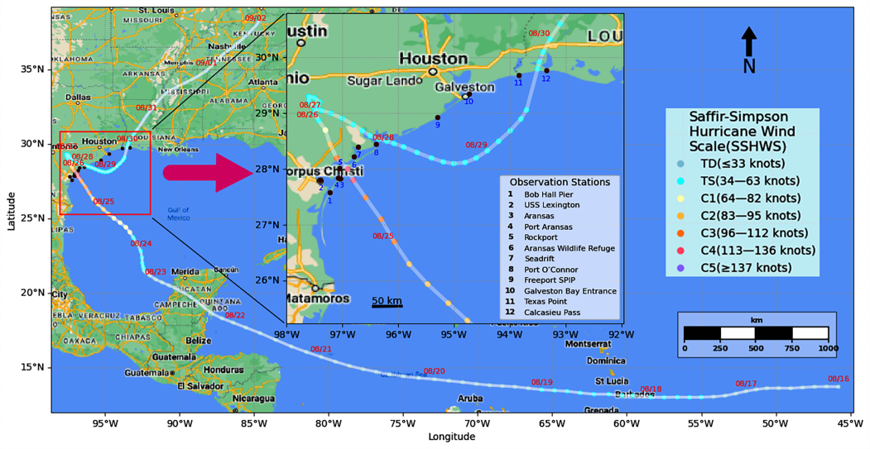
</picture>

## Paper

**Spatiotemporal Deep Learning to Forecast Storm Surge Water Levels and Storm Trajectory: Case Study Hurricane Harvey**  
Junqin Hou, Muhammad K. Akbar, Manar Samad, and Lizhi Ouyang

The paper evaluates one unified modeling idea on three forecasting problems:

1. **ADCIRC+SWAN surrogate modeling** — predict water elevation on a large unstructured coastal mesh for forecast horizons up to 12 hours.
2. **Observation-station forecasting** — forecast water levels at 12 NOAA/NDBC stations near the Hurricane Harvey track.
3. **Hurricane track and attribute forecasting** — forecast latitude, longitude, wind speed, pressure, hurricane category, storm speed, and storm direction.

<picture>
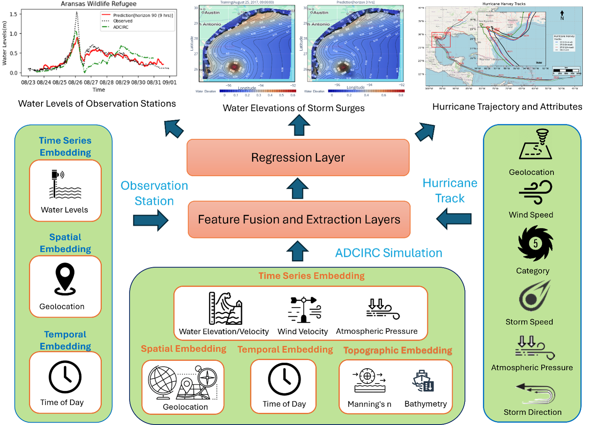
</picture>

---

## Model overview

STERCHA follows the pipeline described in the paper:

<picture>
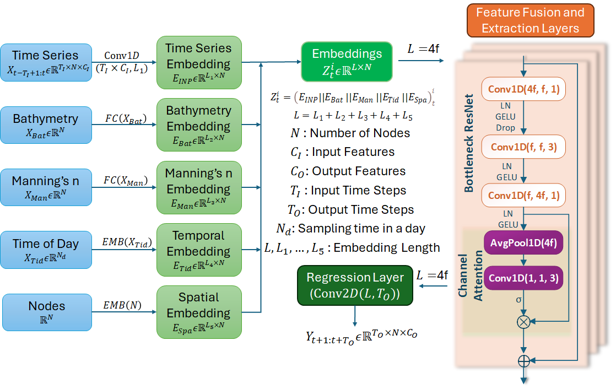
</picture>

For the ADCIRC-surrogate task, the paper uses historical water elevation, water velocity, wind velocity, atmospheric pressure, bathymetry, Manning's n, temporal information, and spatial/node information. The implementation additionally contains optional support for day-of-week embeddings and wave-feature scaling.

## Encoder modules

`models.py` contains several interchangeable feature-extraction modules:

| `encoder_module` | Description |
|---|---|
| `MLP` | Residual pointwise multi-layer perceptron |
| `ResNet` | Residual 1D convolution block |
| `ECABasicBlock` | Residual block with Efficient Channel Attention (ECA) |
| `ECABottleneck` | Bottleneck residual block with ECA; closest to the STERCHA structure described in the paper |
| `ConvNeXtV2_Block` | ConvNeXt-V2-style depthwise convolution + GRN |
| `ConvCAnext` | Hybrid ConvNeXt/residual/channel-attention block |

<picture>
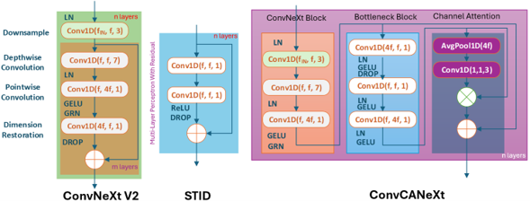
</picture>
For a paper-oriented STERCHA experiment, use:

```python
encoder_module = "ECABottleneck"
```


---

## Data used in the study

### 1. ADCIRC+SWAN storm-surge data

The study used Hurricane Harvey [**ADCIRC+SWAN**](https://adcirc.org//) output generated on the HSOFS mesh. Relevant ADCIRC files described in the paper include:

- `fort.13` — nodal attributes, Manning's n
- `fort.14` — Mesh and bathymetry
- `fort.22` — Wind velocity, atmospheric pressure
- `fort.63` — Water surface elevation, nodal water velocity

The surrogate model uses a subset of wet nodes from the larger mesh and predicts future water elevation from historical dynamic and static features.

<picture>
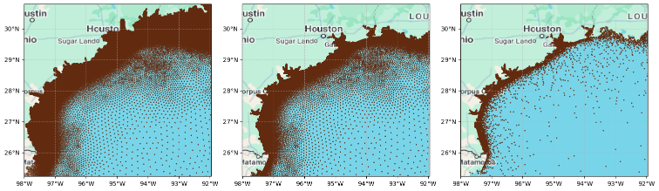
</picture>

### 2. Observation-station water levels

The paper evaluates 12 observation stations of [**National Data Buoy Center**](https://www.ndbc.noaa.gov/) in the Texas/Louisiana coastal region affected by Hurricane Harvey. The station time series are treated as a multi-node, single-output forecasting problem with temporal and spatial embeddings.

### 3. Hurricane track data

Hurricane track and attribute data are obtained from [**IBTrACS**](https://ncics.org/ibtracs/index.php?name=v04r01-2017228N14314). The seven variables described in the paper are:

- Latitude
- Longitude
- Wind speed
- Atmospheric pressure
- Saffir-Simpson Hurricane Wind Scale category
- Storm speed
- Storm direction

---

## Input features for the ADCIRC surrogate

The paper's ablation experiments use the following feature numbering:

| Index | Feature |
|---:|---|
| `0` | Water elevation |
| `1` | Water velocity U |
| `2` | Water velocity V |
| `3` | Wind velocity U |
| `4` | Wind velocity V |
| `5` | Atmospheric pressure |
| `6` | Bathymetry |
| `7` | Manning's n |
| `8` | Time of day |

Spatial/node embedding is normally included separately.

In the current trainer implementation, dynamic state variables `0-5` are inverse-transformed with `scaler`. 


## Repository structure

The supplied archive contains:

```text
STERCHA/
├── models.py     # STERCHA model and alternative encoder blocks
├── train.py      # training, validation, testing, DDP, AMP, rollout
├── metrics.py    # masked MAE, MAPE, MSE, RMSE, WAPE
├── plot.py       # unstructured-mesh visualization helper/example
└── utils.py      # logging helper
```

### Import-path note

The current `train.py` imports modules as:

```python
from models import STERCHA
from utils import log_string
from metrics import masked_mae, masked_mape, masked_rmse
```

Therefore, if you keep those imports unchanged, place the files in a package such as:

```text
STERCHA/
    ├── __init__.py
    ├── models.py
    ├── train.py
    ├── metrics.py
    ├── plot.py
    └── utils.py
```

Alternatively, change the imports in `train.py` to local/relative imports for a flat repository layout.


## Requirements

Experiments with **PyTorch 2.4**, 4 NVIDIA RTX 3090Ti graphics cards or 1 NVIDIA GH200 with 96GB VRAM:

- Python 3.10+
- PyTorch 2.4+
- NumPy
- pandas
- openpyxl
- tqdm
- Matplotlib
- Cartopy

## Example configuration

The exact configuration depends on preprocessing, node count, sampling interval, and experiment. The following is a starting point that follows the paper-oriented model dimensions while matching the keys used by the supplied code:

```python
config = {
    "data": {
        "num_nodes": 8809,
        "input_len": 36,
        "horizon": 36,
        "input_feature_idx": [0, 1, 2, 3, 4, 5],
        "output_feature_idx": [0],
        "sampling_freq_day": 24,  # hourly data; change to match preprocessing
    },
    "STERCHA": {
        "encoder_module": "ECABottleneck",
        "num_layers": 4,

        "input_embedding_dim": 512,
        "spatial_embedding_dim": 128,
        "tod_embedding_dim": 32,
        "dow_embedding_dim": 0,
        "bathy_embedding_dim": 48,
        "manin_embedding_dim": 48,

        "learning_rate": 1e-3,
        "weight_decay": 1e-4,
        "scheduler_factor": 0.97,
        "scheduler_patience": 3,
        "patience": 50,
        "epochs": 200,

        "train_mode": "current",
        "val_mode": "current",
        "test_mode": "rollout",
        "rollout_steps": 36,

        "log": "logs/STERCHA/",
    },
}
```

### Important configuration details

- `num_nodes` must match the number of nodes processed by each model instance because several blocks use node-sized `LayerNorm` parameters and the spatial embedding is created as `[N, E_spatial]`.
- `input_len` must match the historical window used by the dataloader.
- `horizon` controls the direct multi-step output length.
- `sampling_freq_day` must match the number of temporal bins per day. Examples: `24` for hourly data, `96` for 15-minute data, and `240` for 6-minute data.
- `input_feature_idx` and `output_feature_idx` select the dynamic features used by the trainer.

A commonly used experiment setting with learning rate `0.001`, ReduceLROnPlateau decay factor `0.97`, early-stopping patience `50`, batch size `8`, time-series embedding dimension `512`, spatial embedding dimension `128`, time-of-day embedding dimension `32`, and static embedding dimensions around `48` for bathymetry and Manning's n.

---

## Training

Create your preprocessed `datasets` object and instantiate the trainer:

```python
from train import Trainer

trainer = Trainer(
    datasets,
    data=config["data"],
    STERCHA=config["STERCHA"],
)

try:
    trainer.train()
finally:
    trainer.cleanup()
```

The trainer provides:

- Automatic CUDA/CPU device selection
- Automatic mixed precision (AMP) on CUDA
- DistributedDataParallel (DDP) support
- Adam optimization
- ReduceLROnPlateau scheduling
- Early stopping
- Best-checkpoint saving
- Per-subgraph training/validation
- Direct multi-horizon prediction
- Autoregressive rollout evaluation
- MAE, MAPE, and RMSE reporting
- Excel training/evaluation logs
- `.npz` prediction export

---

## Multi-GPU training

The trainer enables DDP automatically when `RANK`, `WORLD_SIZE`, and `LOCAL_RANK` are supplied by `torchrun`.

Example:

```bash
torchrun --standalone --nproc_per_node=4 run_stercha.py
```

Your entry script should build distributed-aware dataloaders using `DistributedSampler` when running with multiple GPUs.

---

## Direct prediction vs. rollout

The model supports two inference modes.

### Direct/current mode

```python
prediction = model(
    x,
    tod,
    dow,
    bathymetry,
    manning,
    mode="current",
)
```

Output:

```text
[B, T_out, N, C_out]
```

All future steps are decoded in one pass.

### Autoregressive rollout mode

```python
prediction = model(
    x,
    tod,
    dow,
    bathymetry,
    manning,
    mode="rollout",
    rollout_steps=12,
)
```

The rollout repeatedly uses the first predicted step as the next input frame.

**Current limitation:** the supplied rollout shifts the `tod`/`dow` sequences but repeats the last available calendar index rather than incrementing it. If temporal embeddings are important during long rollouts, update future time indices explicitly in your preprocessing or rollout logic.

---

## Evaluation outputs

After training, `Trainer.test()` can evaluate:

```text
train | val | test | all
```

For each subgraph, it returns:

```python
{
    "preds": ...,    # [samples, T, N, C]
    "trues": ...,    # [samples, T, N, C]
    "metrics": {
        "mae": ...,
        "rmse": ...,
        "mape": ...,
    },
}
```

Predictions from multiple subgraphs are also concatenated along the node axis:

```text
[B, T, N_1, C] + [B, T, N_2, C] + ...
        -> [B, T, N_total, C]
```

The trainer writes:

```text
logs/STERCHA/
├── best_model.pth
├── log
├── training_results.xlsx
└── predictions_<split>/
    ├── subgraph_1_<split>.npz
    ├── subgraph_2_<split>.npz
    └── combined_<split>.npz
```

## Visualization

`plot.py` contains a `SurgeVisualizer` that uses `matplotlib.tri.Triangulation` and Cartopy to display predictions on an unstructured coastal mesh.

Example concept:

```python
viz = SurgeVisualizer(gdf)

viz.plot_horizon_comparison(
    ground_truth=truth,
    predictions=pred,
    horizons=[0, 3, 6, 9],
    extent=[-98, -92, 25, 31],
)
```

The bottom of the supplied `plot.py` also contains notebook-style example calls (`gdf`, `y_pred_sample`, `plot_interactive`, and `save_interactive_html`) that are not defined in the archive. Treat those lines as examples rather than as a standalone executable script.

---

## Experiments

### ADCIRC+SWAN surrogate

<picture>
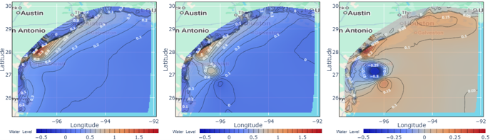
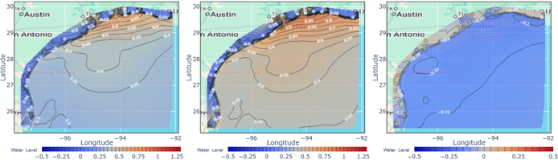
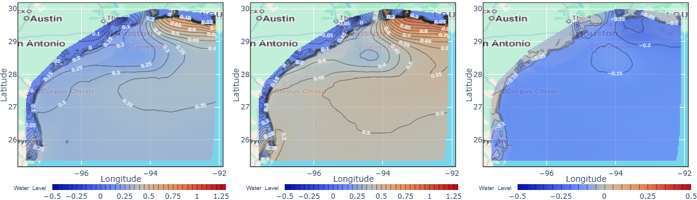
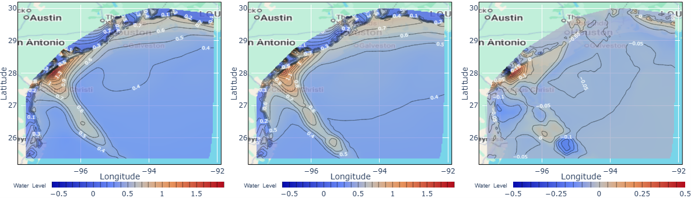
</picture>

### Observation-station forecasting

The paper applies the same high-level embedding/fusion/regression idea to 12 stations. However, the supplied trainer is specialized to the surrogate/subgraph data dictionary and static ADCIRC features. A separate station preprocessing/entry pipeline is therefore required to reproduce this task directly.
<picture>
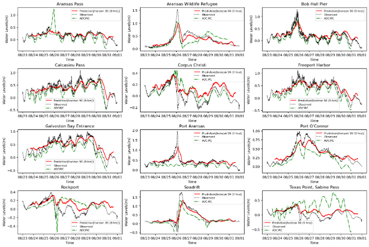
</picture>
### Hurricane trajectory forecasting

The paper treats the hurricane as a single node with seven evolving attributes and uses a CNN-based temporal model without the same ADCIRC embedding setup. The corresponding dedicated track-data loader/experiment script is not included in this archive.
<picture>
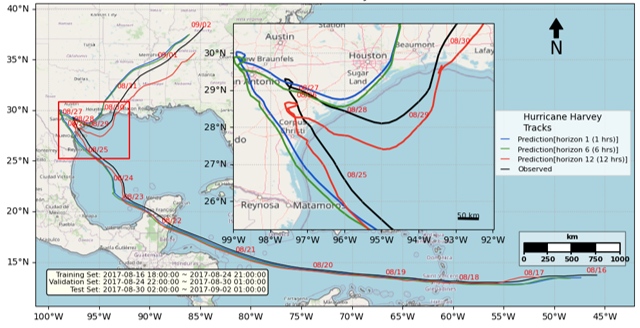
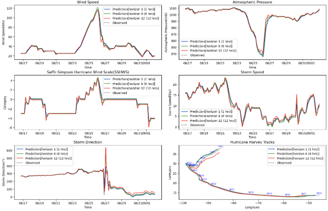
</picture>

### Module Substitution Experiments
The alternative encoders are useful for the architecture-comparison experiments discussed in the manuscript.
<picture>
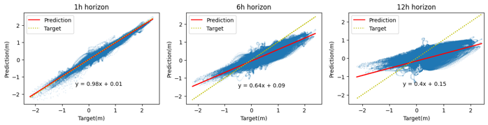
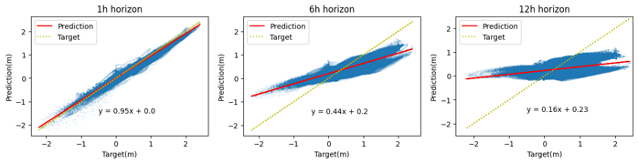
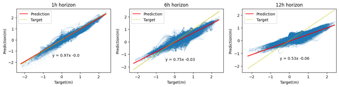
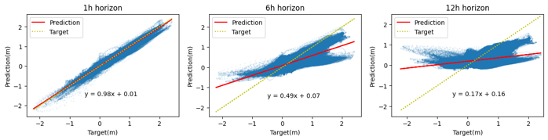
</picture>

### Input Feature Ablation Experiments
The paper also reports ablation experiments on the ADCIRC surrogate task. The following figure shows the reported MAE for different input-feature combinations. 

<picture>
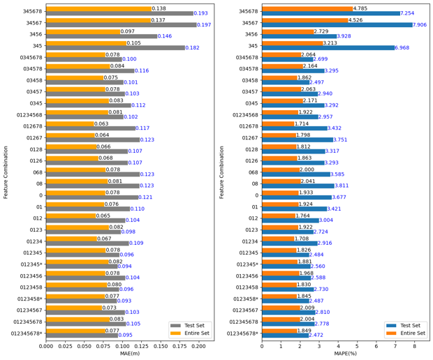
</picture>


## Main findings reported in the manuscript

The Hurricane Harvey experiments reported in the paper indicate that:

- Historical water elevation is the most important input for future surge prediction.
- Wind velocity, atmospheric pressure, and historical water velocity can further improve accuracy.
- Static bathymetry/Manning embeddings did not consistently improve the tested surrogate setup, likely because related spatial/topographic information was already reflected in historical simulated water levels.
- Shorter horizons are more accurate, while spatial displacement and extreme-value errors grow with longer forecasts.
- STERCHA and the heavier ConvCANeXt variant performed better than simpler alternatives for longer-horizon/extreme-value behavior in the reported architecture comparison.
- The station forecasts were competitive with ADCIRC+SWAN at the reported 9-hour horizon.
- The 12-hour hurricane track/attribute forecasts were generally close to observations, with larger errors near abrupt changes.

- The current study is a **Hurricane Harvey case study** rather than a universally trained hurricane surrogate. Generalization to unseen storms requires substantially more simulations and observational data from multiple hurricanes.

---


## Citation

The attached manuscript currently contains placeholder journal metadata. Until the final publication metadata is inserted, cite the work using the available title and authors:

```bibtex
@article{hou_stercha,
  title   = {Spatiotemporal Deep Learning to Forecast Storm Surge Water Levels and Storm Trajectory: Case Study Hurricane Harvey},
  author  = {Hou, Junqin and Akbar, Muhammad K. and Samad, Manar and Ouyang, Lizhi},
  journal = {Journal of Marine Science and Engineering},
  year    = {2025},
  note    = {J. Mar. Sci. Eng. 2025, 13(9), 1780; https://doi.org/10.3390/jmse13091780}
}
```

---

## Licensing

- The text, figures, and data for the paper are licensed under [CC BY 4.0](https://creativecommons.org).
- The source code in this repository is licensed under the [MIT License](LICENSE-CODE).

---

## Acknowledgment of data/model sources

This project builds on storm-surge simulations from [**ADCIRC+SWAN**](https://adcirc.org/), observational water-level data from [**National Data Buoy Center**](https://www.ndbc.noaa.gov/) stations, and hurricane-track data from [**IBTrACS**](https://ncics.org/ibtracs/index.php?name=v04r01-2017228N14314). Users should cite the corresponding datasets and numerical models when reproducing or extending the experiments.
